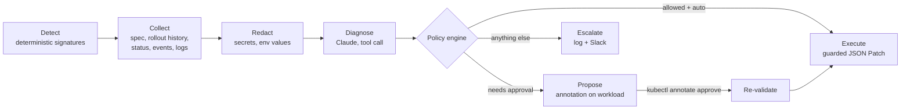

# k8s-self-healing-agent

An LLM-assisted self-healing agent for Kubernetes, running on two clusters on
Google Cloud: **GKE Autopilot** and **self-managed RKE2** on Compute Engine.
It detects failing workloads, asks Claude to diagnose the root cause from real
cluster telemetry, and then applies, proposes, or escalates a fix under
deterministic guardrails.

The core design rule: **the model diagnoses; code decides.** Claude picks one
action from a fixed menu and explains why. Everything that touches the cluster
(whether an action is allowed, which pods, which revision, how much memory,
whether a human must approve) is decided by plain, unit-tested Python.

## Contents

- [How it works](#how-it-works)
- [Guardrails](#guardrails)
- [Failure scenarios](#failure-scenarios)
- [Results](#results)
- [Repository layout](#repository-layout)
- [Quickstart](#quickstart)
  - [Claude API key (platform.claude.com)](#claude-api-key-platformclaudecom)
  - [Steps](#steps)
- [Running the scenarios](#running-the-scenarios)
  - [1. Watch the agent](#1-watch-the-agent)
  - [2. Scenario 1: bad rollout](#2-scenario-1-bad-rollout)
  - [3. Scenarios 2, 3 and 4](#3-scenarios-2-3-and-4)
  - [4. Approve the scenario 2 proposal](#4-approve-the-scenario-2-proposal)
  - [5. Check the end state](#5-check-the-end-state)
  - [6. Reset](#6-reset)
  - [7. Tear down](#7-tear-down)
- [Security posture](#security-posture)
- [Cost and teardown](#cost-and-teardown)
- [Limits and next steps](#limits-and-next-steps)

## How it works



1. **Detect.** Every 30 s the agent scans opted-in pods
   (`healer.birmingham.github.io/managed=true`) for known signatures:
   `OOMKilled`, `ImagePullBackOff`, `CreateContainerConfigError`,
   `CrashLoopBackOff`, `Unschedulable`. No LLM here: detection is cheap,
   predictable, and testable.
2. **Collect.** For the owning Deployment: pod template, the last four rollout
   revisions, container statuses, events, and the tail of current and previous
   container logs.
3. **Redact.** Env var *values* never leave the cluster (names and sources
   only). Logs are scrubbed for passwords, tokens, connection strings, and keys.
4. **Diagnose.** Claude answers through a single tool,
   `propose_remediation`, whose `action` field is an enum:
   `restart_pod`, `rollback_deployment`, `increase_memory_limit`, `escalate`.
   It returns a root cause, cited evidence, a confidence, and an on-call summary.
   A plain-text reply, an out-of-enum value, or an API error is treated as a
   failed diagnosis and escalated.
5. **Decide.** The policy engine (`agent/healer/policy.py`) applies the guardrails below.
6. **Act.** Mutations are JSON Patches with `test` operations, so if a human or
   a GitOps controller changed the Deployment while the agent was thinking,
   the patch fails and the agent escalates instead of overwriting.

## Guardrails

| Guardrail | What it does |
|---|---|
| Fixed action menu | The model can only choose from four actions. It never writes commands, targets, or numbers. |
| Signature-to-action map | `restart_pod` is not a valid fix for `ImagePullBackOff`, so it's rejected even at 99% confidence. |
| Deterministic parameters | Rollback target = previous revision. Memory = current × 2, capped at 1Gi. Computed in code. |
| Preconditions | No rollback without an earlier revision. No memory change if the container has no limit or is at the ceiling. |
| Confidence threshold | Below 0.7, an auto action becomes a proposal. |
| Per-action modes | `auto`, `propose`, or `disabled` per action in `policy.yaml`. Resource changes default to `propose`. |
| Don't repeat a failed fix | If the same signature recurs after an action, escalate rather than retry. |
| Circuit breaker | At most 3 actions per workload per hour. |
| Cooldowns | 5 min after a diagnosis, 60 min after an escalation, so a stuck workload doesn't burn tokens or page repeatedly. |
| Re-validation on approval | Approved proposals are recomputed against the live object and refused if anything changed. |
| Optimistic concurrency | Every spec patch tests `metadata.generation` first. |
| Opt-in and namespace scope | Only labeled pods in `healer-demo`. RBAC is a namespaced Role, not a ClusterRole. |
| LLM outage | API failure or a malformed answer becomes an escalation. The agent never acts without a valid diagnosis. |
| Dry-run | `dryRun: true` turns every action into a proposal. |

All agent state (action history, pending proposals, cooldowns) lives in
annotations on the Deployment itself, so it survives agent restarts and
`kubectl describe` shows exactly what the agent did and why.

## Failure scenarios

| # | Scenario | What breaks | Expected agent behavior |
|---|---|---|---|
| 1 | Bad rollout | Image tag typo in revision 2. `maxUnavailable: 0` keeps old pods serving, but the rollout is stuck. | **Auto rollback** to revision 1 |
| 2 | OOM | Working set (~400 MiB) outgrew a 256Mi limit | **Proposes** 256Mi to 512Mi; a human approves; agent applies |
| 3 | Corrupt local cache | `emptyDir` state is corrupted. Container restarts keep the volume, so it crash-loops forever. | **Auto restart_pod**: a new pod gets a fresh volume |
| 4 | Missing config | Brand-new service missing `DATABASE_URL`, no earlier revision | **Escalates** with a diagnosis and changes nothing |

Scenario 3 is the interesting one: the kubelet's built-in self-healing
(restarting the container) is exactly what *doesn't* work, and the evidence for
why is in the logs and the volume type. Scenario 4 shows the agent knowing when
not to act.

See [Running the scenarios](#running-the-scenarios) for the full walkthrough
with expected output at each step.

## Results

All four scenarios passed on both clusters, with the same agent image and
policy and no per-cluster code (agent `0.1.2`, model `claude-sonnet-5-5`,
GKE Autopilot on the REGULAR channel, RKE2 `v1.36.5+rke2r1`, October 2026).

| Scenario | GKE Autopilot | RKE2 | Outcome on both |
|---|---|---|---|
| 1. Bad image tag | 7 s | 8 s | Auto rollback |
| 2. OOM | Approved, applied | Approved, applied | Proposal → human approval → 512Mi |
| 3. Corrupt cache | 7 s | 9 s | Auto pod restart |
| 4. Missing config | Escalated (0.95 confidence) | Escalated | No changes; on-call summary |

Times are from incident detection to the executed action, including the Claude
call. The diagnoses were consistent across clusters but not identical, because
the model reasons from each cluster's live telemetry: on RKE2 it quoted the
registry's "not found" pull event in scenario 1, and in scenario 2 it noted the
limit had been too low since revision 1, ruling out a recent regression.

## Repository layout

```
agent/                 Python agent (python -m healer), Dockerfile, tests
  healer/detector.py   failure signatures
  healer/collector.py  telemetry gathering
  healer/redact.py     secret scrubbing
  healer/diagnoser.py  Claude call, forced tool schema
  healer/policy.py     guardrails and parameter computation
  healer/actions.py    guarded JSON Patch executors
  healer/state.py      annotation-backed state
  healer/agent.py      control loop and approval flow
deploy/                kustomize base + overlays per cluster
infra/gke-autopilot/   Terraform: VPC, NAT, node SA, private Autopilot cluster
infra/rke2/            Terraform: VPC, NAT, IAP firewall, 1 server + 2 agents
scenarios/             four failure scenarios + runner
scripts/               build, connect, deploy, watch, approve helpers
```

Terraform is split per concern (`provider.tf`, `variables.tf`, `apis.tf`,
`network.tf`, `sa.tf`, `firewall.tf`, `compute.tf` / `gke_autopilot.tf`,
`outputs.tf`), with remote state in GCS via a gitignored `backend.hcl`.

## Quickstart

Prerequisites: `gcloud` (with `gke-gcloud-auth-plugin`), Terraform ≥ 1.6,
`kubectl`, Docker with buildx, `jq`, a GCS bucket for state, and a Claude API key from
[platform.claude.com](https://platform.claude.com) (see below).

### Claude API key (platform.claude.com)

The agent calls the Claude API, which needs its own key from the Claude
Console at [platform.claude.com](https://platform.claude.com). A claude.ai
subscription does not include API access; the Console has separate billing.

1. Sign in to the Console (the same login as claude.ai works).
2. Under **Billing**, add credits. Set a monthly spend limit and an alert while
   you're there. Each incident costs one API call, and cooldowns stop repeats,
   so a few dollars covers many scenario runs.
3. Create a **workspace** for this project (e.g. `k8s-self-healing-agent`), then
   create the API key **inside that workspace**. Some accounts reject keys that
   aren't scoped to a workspace with a 400: *"This API key is not scoped to a
   workspace..."*. A dedicated workspace also gives the agent its own spend cap.
4. Store the key with `scripts/store-api-key.sh` (step 2 below). It prompts
   without echoing, so the key never lands in shell history or a file.

To confirm the key and model work before deploying (the key goes through a
pipe, never into argv):

```bash
gcloud secrets versions access latest --secret=anthropic-api-key --project "$PROJECT" \
  | sed 's/^/x-api-key: /' \
  | curl -s https://api.anthropic.com/v1/messages -H @- \
      -H "anthropic-version: 2023-06-01" -H "content-type: application/json" \
      -d '{"model":"claude-sonnet-5-5","max_tokens":20,"messages":[{"role":"user","content":"Reply with OK"}]}'
```

A JSON reply containing `"text":"OK"` means you're ready. If the agent ever
can't reach the API, it escalates instead of acting, and the API's own error
message appears in the `diagnosis` log line.

After rotating the key, re-run `scripts/deploy-agent.sh`, then
`kubectl -n healer-system rollout restart deploy/healer`. Pods read Secret
values only at startup.

### Steps

**One-time setup.** These results live outside the clusters (GHCR and Secret
Manager), so they survive `terraform destroy`. Skip them on later sessions.

```bash
# 1. Agent image. CI publishes it when you push a v* tag; the version deployed
#    is the newTag in deploy/base/kustomization.yaml. Make the GHCR package
#    public once (Package settings -> Change visibility) so clusters can pull it.
git tag v0.1.2 && git push origin v0.1.2      # only if that tag isn't published yet

# 2. Store the workspace-scoped Claude API key in Secret Manager (prompted, not echoed).
#    If you rotate the key in the Claude Console (platform.claude.com), run this
#    again with the new key: Secret Manager keeps the old one until you do.
scripts/store-api-key.sh "$PROJECT"

#    Verify the stored key (and workspace, billing, model): expect "text":"OK".
gcloud secrets versions access latest --secret=anthropic-api-key --project "$PROJECT" \
  | sed 's/^/x-api-key: /' \
  | curl -s https://api.anthropic.com/v1/messages -H @- \
      -H "anthropic-version: 2023-06-01" -H "content-type: application/json" \
      -d '{"model":"claude-sonnet-5-5","max_tokens":20,"messages":[{"role":"user","content":"Reply with OK"}]}'

#    After a rotation, disable the revoked key's old version:
gcloud secrets versions list anthropic-api-key --project "$PROJECT"
gcloud secrets versions disable <OLD_VERSION> --secret=anthropic-api-key --project "$PROJECT"
```

If clusters are running when you rotate, also re-run `scripts/deploy-agent.sh`
and `kubectl -n healer-system rollout restart deploy/healer` on each, since
pods read Secret values only at startup.

**Each session.** Bring up the clusters and deploy the agent. Every script
takes the project ID as its first argument; in a new terminal, set it first
with `export PROJECT=$(gcloud config get-value project)`. The `cp` lines
are only needed the first time; your `terraform.tfvars` and `backend.hcl` are
gitignored and stay on disk.

```bash
# 3. GKE Autopilot (~10 minutes).
cd infra/gke-autopilot
cp terraform.tfvars.example terraform.tfvars   # first time: set project_id and your IP/32
cp backend.hcl.example backend.hcl             # first time: set your state bucket
terraform init -backend-config=backend.hcl && terraform apply
cd ../..
# Run after terraform apply finishes. Until the cluster is RUNNING its API
# refuses connections; the script waits for RUNNING if you start it early.
scripts/connect-gke.sh "$PROJECT"

# 4. RKE2 (bootstrap takes ~5 minutes after apply).
cd infra/rke2
cp terraform.tfvars.example terraform.tfvars   # first time
cp backend.hcl.example backend.hcl             # first time
terraform init -backend-config=backend.hcl && terraform apply
cd ../..
scripts/connect-rke2.sh "$PROJECT"             # leave running; it holds the IAP tunnel

# 5. In a new terminal: deploy the agent to both clusters.
export KUBECONFIG="$HOME/.kube/config:$HOME/.kube/healer-rke2-kubeconfig.yaml"
scripts/deploy-agent.sh healer-gke  "$PROJECT"
scripts/deploy-agent.sh healer-rke2 "$PROJECT"
```

**What a healthy connection looks like.** `connect-gke.sh` ends by running
`kubectl --context healer-gke get ns`. Before the agent is deployed, expect only
the system namespaces, all `Active`:

```
NAME                                STATUS   AGE
default                             Active   5m
gke-gmp-system                      Active   2m
gke-managed-cim                     Active   3m
gke-managed-system                  Active   3m
gmp-public                          Active   2m
kube-node-lease                     Active   5m
kube-public                         Active   5m
kube-system                         Active   5m
```

The exact `gke-*` / `gmp-*` set varies with the GKE version (you may see
`gke-managed-filestorecsi`, `gke-managed-volumepopulator`, and others); any
list like this means you're connected. `kubectl get nodes` may show no nodes at
all: Autopilot adds nodes only when pods need them. After `deploy-agent.sh`,
`healer-system` and `healer-demo` appear in the list.

For RKE2, `kubectl --context healer-rke2 get nodes` should show three `Ready`
nodes, named by their internal hostnames:

```
NAME                                                     STATUS   ROLES                AGE   VERSION
healer-rke2-agent-0.us-west1-a.c.<project>.internal      Ready    <none>               22m   v1.xx.x+rke2r1
healer-rke2-agent-1.us-west1-a.c.<project>.internal      Ready    <none>               22m   v1.xx.x+rke2r1
healer-rke2-server-0.us-west1-a.c.<project>.internal     Ready    control-plane,etcd   22m   v1.xx.x+rke2r1
```

Nodes report `NotReady` for the first minute or two while Canal starts. The
version is whatever the RKE2 `stable` channel ships at apply time; set
`rke2_version` in `terraform.tfvars` to pin it.

**When things change:**

| Change | What to do |
|---|---|
| Agent code | Bump `__version__` in `agent/healer/__init__.py` and `newTag` in `deploy/base/kustomization.yaml`, push a new `v*` tag, wait for CI, re-run `deploy-agent.sh`. Never re-push an existing tag: nodes cache images by tag. |
| API key rotated | `scripts/store-api-key.sh`, then `deploy-agent.sh` and `kubectl -n healer-system rollout restart deploy/healer` on any running cluster. |
| Manifests only | Re-run `deploy-agent.sh`. |

For local builds instead of CI (`scripts/build-push.sh <version>`), log in to
GHCR first with a classic token that has `write:packages`, and use a new version
number rather than an existing one.

Optional Slack notifications: add a `SLACK_WEBHOOK_URL` key to the
`healer-secrets` Secret in `healer-system`.

## Running the scenarios

The steps are identical on both clusters. Pick one per run:

```bash
CTX=healer-gke        # or: CTX=healer-rke2
```

### 1. Watch the agent

In its own terminal:

```bash
scripts/watch.sh $CTX
```

The first line is the agent's startup event:

```
16:20:13  INFO  agent_started
```

Leave it running. Each scenario below produces four lines here:
`incident_detected`, `diagnosis`, `decision`, and either `action_executed` or
`proposal_created`. Incidents appear 1 to 2 minutes after a failure starts:
the agent waits until a failing pod is 45 seconds old, so the kubelet's own
retries happen first, and it scans every 30 seconds.

### 2. Scenario 1: bad rollout

```bash
scenarios/run.sh --context $CTX 1
```

```
deployment.apps/web created
deployment "web" successfully rolled out
>> shipping a bad image tag (revision 2)
deployment.apps/web image updated
>> expect: ImagePullBackOff -> agent rolls back to revision 1 automatically
```

Expected in the watch window:

```
16:33:13  WARNING  incident_detected  healer-demo/web/ImagePullBackOff
16:33:21  INFO  diagnosis  healer-demo/web/ImagePullBackOff    rollback_deployment  Revision 2 changed the web container image tag to a nonexistent one, "nginxinc/nginx-unprivileged:1.27-alpinee". The extra "e" is a typo. ...
16:33:21  INFO  decision  healer-demo/web/ImagePullBackOff  execute  rollback_deployment  allowed by policy (auto)
16:33:21  NOTICE  action_executed  healer-demo/web/ImagePullBackOff    rollback_deployment
```

Confirm the rollback:

```bash
kubectl --context $CTX -n healer-demo get pods
kubectl --context $CTX -n healer-demo rollout history deploy/web
kubectl --context $CTX -n healer-demo get deploy web \
  -o jsonpath='{.spec.template.spec.containers[0].image}'; echo
```

```
NAME                   READY   STATUS    RESTARTS   AGE
web-5594779c6b-8w8k8   1/1     Running   0          3m
web-5594779c6b-svg5j   1/1     Running   0          3m

REVISION  CHANGE-CAUSE
2         <none>
3         <none>

nginxinc/nginx-unprivileged:1.27-alpine
```

Two Running pods, no `ImagePullBackOff`, and the original image. Revision 1
is missing from the history on purpose: a rollback reuses revision 1's
ReplicaSet and renumbers it as revision 3, exactly like `kubectl rollout undo`.

### 3. Scenarios 2, 3 and 4

These can be launched back to back; the agent handles each Deployment as its
own incident.

```bash
scenarios/run.sh --context $CTX 3     # corrupt local cache
scenarios/run.sh --context $CTX 2     # OOM
scenarios/run.sh --context $CTX 4     # missing config
```

Expected decisions in the watch window:

```
...  diagnosis  healer-demo/cache-worker/CrashLoopBackOff  restart_pod  ... emptyDir contents survive container restarts within the same pod ...
...  decision   healer-demo/cache-worker/CrashLoopBackOff  execute  restart_pod  allowed by policy (auto)
...  diagnosis  healer-demo/cruncher/OOMKilled  increase_memory_limit  ... limit (256Mi) is below its legitimate, bounded working set of about 400 MiB ...
...  decision   healer-demo/cruncher/OOMKilled  propose  increase_memory_limit  policy requires human approval
...  proposal_created  healer-demo/cruncher/OOMKilled  kubectl -n healer-demo annotate deploy/cruncher healer.birmingham.github.io/approve=69e8a73f --overwrite
...  diagnosis  healer-demo/api/CrashLoopBackOff  escalate  ... the required DATABASE_URL environment variable is not set ...
...  decision   healer-demo/api/CrashLoopBackOff  escalate  escalate  model recommended escalation
```

### 4. Approve the scenario 2 proposal

The memory increase waits for a human. Review and approve it:

```bash
scripts/approve.sh cruncher $CTX
```

```
{
  "action": "increase_memory_limit",
  "confidence": 0.9,
  "container": "cruncher",
  "created": "2026-10-13T16:39:51+00:00",
  "id": "69e8a73f",
  "incident": "healer-demo/cruncher/OOMKilled",
  "params": {
    "container": "cruncher",
    "from": "256Mi",
    "to": "512Mi"
  },
  "reason": "policy requires human approval",
  "root_cause": "The cruncher container's memory limit (256Mi) is below its legitimate, bounded working set of about 400 MiB. ...",
  "signature": "OOMKilled"
}
Approve proposal 69e8a73f? [y/N] y
deployment.apps/cruncher annotated
approved; the agent re-validates and applies it on its next loop (<= 30s).
```

Within 30 seconds the watch window shows
`action_executed  healer-demo/cruncher/OOMKilled  increase_memory_limit`.
Confirm the new limit:

```bash
kubectl --context $CTX -n healer-demo get deploy cruncher \
  -o jsonpath='{.spec.template.spec.containers[0].resources}'; echo
```

```
{"limits":{"memory":"512Mi"},"requests":{"cpu":"250m","memory":"512Mi"}}
```

On GKE Autopilot the output also includes `ephemeral-storage`, which Autopilot
adds to every pod.

### 5. Check the end state

```bash
kubectl --context $CTX -n healer-demo get pods
```

```
NAME                            READY   STATUS             RESTARTS        AGE
api-558d6db59f-9kbrr            0/1     CrashLoopBackOff   5 (2m32s ago)   5m18s
cache-worker-7c988c878b-q5pn2   1/1     Running            0               3m7s
cruncher-5dbcf44b49-8l22z       1/1     Running            0               3m16s
web-677f7b6598-57c8c            1/1     Running            0               12m
web-677f7b6598-nrhvp            1/1     Running            0               12m
```

Everything is Running except `api`, which stays in `CrashLoopBackOff` by
design: it needs a configuration change that only a human can make.
`cache-worker` shows 0 restarts because the agent replaced the pod.

### 6. Reset

```bash
scenarios/run.sh --context healer-gke reset
scenarios/run.sh --context healer-rke2 reset
```

```
deployment.apps "api" deleted from healer-demo namespace
deployment.apps "cache-worker" deleted from healer-demo namespace
deployment.apps "cruncher" deleted from healer-demo namespace
deployment.apps "web" deleted from healer-demo namespace
```

A cluster with no scenarios running prints `No resources found`, which is also
fine. The agent keeps running; re-running any scenario starts it fresh.

### 7. Tear down

1. Close the `connect-rke2.sh` terminal with Ctrl-C (it holds the IAP tunnel).
2. Destroy both stacks. Each takes a few minutes and ends with
   `Destroy complete!`:

   ```bash
   cd infra/rke2 && terraform destroy
   cd ../gke-autopilot && terraform destroy
   cd ../..
   ```

These are left behind on purpose and cost nothing or close to it: the API key
in Secret Manager, the Terraform state bucket, and the agent image in GHCR.
Next session starts at step 3 of [Steps](#steps).

## Security posture

- **Prompt injection.** Logs are attacker-controllable input. The system prompt
  marks telemetry as untrusted, but the real defense is structural: even a
  fully hijacked model can only pick from four actions, and code decides
  targets, values, and whether the action is allowed at all.
- **Least privilege.** The agent's ServiceAccount can read pods, logs, events,
  and ReplicaSets, delete pods, and patch Deployments, only in `healer-demo`.
  No Secrets, no `exec`, nothing cluster-scoped. It needs no GCP IAM
  permissions at all.
- **Data minimization.** Env var values are never sent to the model; logs are
  redacted and truncated before the API call.
- **Secret handling.** The API key goes Secret Manager to Kubernetes Secret
  through a pipe, never touching disk or argv.
- **Networks.** No external IPs on any node. Egress via Cloud NAT; RKE2 SSH and
  API access only through IAP; the Autopilot control plane accepts only
  `authorized_cidrs`.
- **Agent container.** Non-root, read-only root filesystem, all capabilities
  dropped, `restricted` Pod Security Standard on its namespace.

## Cost and teardown

While both clusters are up, expect very roughly $0.50 to $0.70 per hour
(three `e2-standard-4` VMs, two Cloud NAT gateways, the Autopilot cluster fee
and pod resources). Each diagnosis is one Claude call; cooldowns keep that to
a handful per incident. Tear down when you're done; see
[Tear down](#7-tear-down).

## Limits and next steps

- **Single replica.** One agent per cluster, `Recreate` strategy. Running
  replicas would need leader election (a `coordination.k8s.io` Lease).
- **GitOps drift.** A rollback or memory change made in-cluster will be
  reverted by Argo CD or Flux. The escalation summary says what the permanent
  fix is; the natural next step is opening a pull request against the GitOps
  repo instead of patching live.
- **Defense in depth.** A `ValidatingAdmissionPolicy` could restrict the
  agent's ServiceAccount to changing only images and memory resources, so even
  a bug in the agent can't modify anything else.
- **More signals.** Prometheus SLO burn rates, node conditions, and failing
  readiness probes are natural next detectors.
