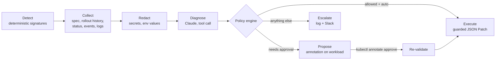

# k8s-self-healing-agent

An LLM-assisted self-healing agent for Kubernetes, running on two clusters on
Google Cloud: **GKE Autopilot** and **self-managed RKE2** on Compute Engine.
It detects failing workloads, asks Claude to diagnose the root cause from real
cluster telemetry, and then applies, proposes, or escalates a fix under
deterministic guardrails.

The core design rule: **the model diagnoses; code decides.** Claude picks one
action from a fixed menu and explains why. Everything that touches the cluster
(whether an action is allowed, which pods, which revision, how much memory,
whether a human must approve) is decided by plain, unit-tested Python.

## Contents

- [How it works](#how-it-works)
- [Guardrails](#guardrails)
- [Failure scenarios](#failure-scenarios)
- [Repository layout](#repository-layout)
- [Quickstart](#quickstart)
  - [Claude API key (platform.claude.com)](#claude-api-key-platformclaudecom)
  - [Steps](#steps)
- [Security posture](#security-posture)
- [Cost and teardown](#cost-and-teardown)
- [Limits and next steps](#limits-and-next-steps)

## How it works



1. **Detect.** Every 30 s the agent scans opted-in pods
   (`healer.birmingham.github.io/managed=true`) for known signatures:
   `OOMKilled`, `ImagePullBackOff`, `CreateContainerConfigError`,
   `CrashLoopBackOff`, `Unschedulable`. No LLM here: detection is cheap,
   predictable, and testable.
2. **Collect.** For the owning Deployment: pod template, the last four rollout
   revisions, container statuses, events, and the tail of current and previous
   container logs.
3. **Redact.** Env var *values* never leave the cluster (names and sources
   only). Logs are scrubbed for passwords, tokens, connection strings, and keys.
4. **Diagnose.** Claude answers through a single tool,
   `propose_remediation`, whose `action` field is an enum:
   `restart_pod`, `rollback_deployment`, `increase_memory_limit`, `escalate`.
   It returns a root cause, cited evidence, a confidence, and an on-call summary.
   A plain-text reply, an out-of-enum value, or an API error is treated as a
   failed diagnosis and escalated.
5. **Decide.** The policy engine (`agent/healer/policy.py`) applies the guardrails below.
6. **Act.** Mutations are JSON Patches with `test` operations, so if a human or
   a GitOps controller changed the Deployment while the agent was thinking,
   the patch fails and the agent escalates instead of overwriting.

## Guardrails

| Guardrail | What it does |
|---|---|
| Fixed action menu | The model can only choose from four actions. It never writes commands, targets, or numbers. |
| Signature-to-action map | `restart_pod` is not a valid fix for `ImagePullBackOff`, so it's rejected even at 99% confidence. |
| Deterministic parameters | Rollback target = previous revision. Memory = current × 2, capped at 1Gi. Computed in code. |
| Preconditions | No rollback without an earlier revision. No memory change if the container has no limit or is at the ceiling. |
| Confidence threshold | Below 0.7, an auto action becomes a proposal. |
| Per-action modes | `auto`, `propose`, or `disabled` per action in `policy.yaml`. Resource changes default to `propose`. |
| Don't repeat a failed fix | If the same signature recurs after an action, escalate rather than retry. |
| Circuit breaker | At most 3 actions per workload per hour. |
| Cooldowns | 5 min after a diagnosis, 60 min after an escalation, so a stuck workload doesn't burn tokens or page repeatedly. |
| Re-validation on approval | Approved proposals are recomputed against the live object and refused if anything changed. |
| Optimistic concurrency | Every spec patch tests `metadata.generation` first. |
| Opt-in and namespace scope | Only labeled pods in `healer-demo`. RBAC is a namespaced Role, not a ClusterRole. |
| LLM outage | API failure or a malformed answer becomes an escalation. The agent never acts without a valid diagnosis. |
| Dry-run | `dryRun: true` turns every action into a proposal. |

All agent state (action history, pending proposals, cooldowns) lives in
annotations on the Deployment itself, so it survives agent restarts and
`kubectl describe` shows exactly what the agent did and why.

## Failure scenarios

| # | Scenario | What breaks | Expected agent behavior |
|---|---|---|---|
| 1 | Bad rollout | Image tag typo in revision 2. `maxUnavailable: 0` keeps old pods serving, but the rollout is stuck. | **Auto rollback** to revision 1 |
| 2 | OOM | Working set (~400 MiB) outgrew a 256Mi limit | **Proposes** 256Mi to 512Mi; a human approves; agent applies |
| 3 | Corrupt local cache | `emptyDir` state is corrupted. Container restarts keep the volume, so it crash-loops forever. | **Auto restart_pod**: a new pod gets a fresh volume |
| 4 | Missing config | Brand-new service missing `DATABASE_URL`, no earlier revision | **Escalates** with a diagnosis and changes nothing |

Scenario 3 is the interesting one: the kubelet's built-in self-healing
(restarting the container) is exactly what *doesn't* work, and the evidence for
why is in the logs and the volume type. Scenario 4 shows the agent knowing when
not to act.

```bash
scenarios/run.sh --context healer-gke 1      # bad rollout
scenarios/run.sh --context healer-rke2 3     # corrupt cache
scripts/watch.sh healer-gke                  # follow the agent's decisions
scripts/approve.sh cruncher healer-gke       # approve the scenario 2 proposal
scenarios/run.sh --context healer-gke reset
```

## Repository layout

```
agent/                 Python agent (python -m healer), Dockerfile, tests
  healer/detector.py   failure signatures
  healer/collector.py  telemetry gathering
  healer/redact.py     secret scrubbing
  healer/diagnoser.py  Claude call, forced tool schema
  healer/policy.py     guardrails and parameter computation
  healer/actions.py    guarded JSON Patch executors
  healer/state.py      annotation-backed state
  healer/agent.py      control loop and approval flow
deploy/                kustomize base + overlays per cluster
infra/gke-autopilot/   Terraform: VPC, NAT, node SA, private Autopilot cluster
infra/rke2/            Terraform: VPC, NAT, IAP firewall, 1 server + 2 agents
scenarios/             four failure scenarios + runner
scripts/               build, connect, deploy, watch, approve helpers
```

Terraform is split per concern (`provider.tf`, `variables.tf`, `apis.tf`,
`network.tf`, `sa.tf`, `firewall.tf`, `compute.tf` / `gke_autopilot.tf`,
`outputs.tf`), with remote state in GCS via a gitignored `backend.hcl`.

## Quickstart

Prerequisites: `gcloud` (with `gke-gcloud-auth-plugin`), Terraform ≥ 1.6,
`kubectl`, Docker with buildx, `jq`, a GCS bucket for state, and a Claude API key from
[platform.claude.com](https://platform.claude.com) (see below).

### Claude API key (platform.claude.com)

The agent calls the Claude API, which needs its own key from the Claude
Console at [platform.claude.com](https://platform.claude.com). A claude.ai
subscription does not include API access; the Console has separate billing.

1. Sign in to the Console (the same login as claude.ai works).
2. Under **Billing**, add credits. Set a monthly spend limit and an alert while
   you're there. Each incident costs one API call, and cooldowns stop repeats,
   so a few dollars covers many scenario runs.
3. Create a **workspace** for this project (e.g. `k8s-self-healing-agent`), then
   create the API key **inside that workspace**. Some accounts reject keys that
   aren't scoped to a workspace with a 400: *"This API key is not scoped to a
   workspace..."*. A dedicated workspace also gives the agent its own spend cap.
4. Store the key with `scripts/store-api-key.sh` (step 2 below). It prompts
   without echoing, so the key never lands in shell history or a file.

To confirm the key and model work before deploying (the key goes through a
pipe, never into argv):

```bash
gcloud secrets versions access latest --secret=anthropic-api-key --project "$PROJECT" \
  | sed 's/^/x-api-key: /' \
  | curl -s https://api.anthropic.com/v1/messages -H @- \
      -H "anthropic-version: 2023-06-01" -H "content-type: application/json" \
      -d '{"model":"claude-sonnet-5-5","max_tokens":20,"messages":[{"role":"user","content":"Reply with OK"}]}'
```

A JSON reply containing `"text":"OK"` means you're ready. If the agent ever
can't reach the API, it escalates instead of acting, and the API's own error
message appears in the `diagnosis` log line.

After rotating the key, re-run `scripts/deploy-agent.sh`, then
`kubectl -n healer-system rollout restart deploy/healer`. Pods read Secret
values only at startup.

### Steps

**One-time setup.** These results live outside the clusters (GHCR and Secret
Manager), so they survive `terraform destroy`. Skip them on later sessions.

```bash
# 1. Agent image. CI publishes it when you push a v* tag; the version deployed
#    is the newTag in deploy/base/kustomization.yaml. Make the GHCR package
#    public once (Package settings -> Change visibility) so clusters can pull it.
git tag v0.1.2 && git push origin v0.1.2      # only if that tag isn't published yet

# 2. Store the workspace-scoped Claude API key in Secret Manager (prompted, not echoed).
scripts/store-api-key.sh "$PROJECT"
```

**Each session.** Bring up the clusters and deploy the agent. The `cp` lines
are only needed the first time; your `terraform.tfvars` and `backend.hcl` are
gitignored and stay on disk.

```bash
# 3. GKE Autopilot (~10 minutes).
cd infra/gke-autopilot
cp terraform.tfvars.example terraform.tfvars   # first time: set project_id and your IP/32
cp backend.hcl.example backend.hcl             # first time: set your state bucket
terraform init -backend-config=backend.hcl && terraform apply
cd ../..
scripts/connect-gke.sh "$PROJECT"

# 4. RKE2 (bootstrap takes ~5 minutes after apply).
cd infra/rke2
cp terraform.tfvars.example terraform.tfvars   # first time
cp backend.hcl.example backend.hcl             # first time
terraform init -backend-config=backend.hcl && terraform apply
cd ../..
scripts/connect-rke2.sh "$PROJECT"             # leave running; it holds the IAP tunnel

# 5. In a new terminal: deploy the agent to both clusters.
export KUBECONFIG="$HOME/.kube/config:$HOME/.kube/healer-rke2-kubeconfig.yaml"
scripts/deploy-agent.sh healer-gke  "$PROJECT"
scripts/deploy-agent.sh healer-rke2 "$PROJECT"
```

**When things change:**

| Change | What to do |
|---|---|
| Agent code | Bump `__version__` in `agent/healer/__init__.py` and `newTag` in `deploy/base/kustomization.yaml`, push a new `v*` tag, wait for CI, re-run `deploy-agent.sh`. Never re-push an existing tag: nodes cache images by tag. |
| API key rotated | `scripts/store-api-key.sh`, then `deploy-agent.sh` and `kubectl -n healer-system rollout restart deploy/healer` on any running cluster. |
| Manifests only | Re-run `deploy-agent.sh`. |

For local builds instead of CI (`scripts/build-push.sh <version>`), log in to
GHCR first with a classic token that has `write:packages`, and use a new version
number rather than an existing one.

Optional Slack notifications: add a `SLACK_WEBHOOK_URL` key to the
`healer-secrets` Secret in `healer-system`.

## Security posture

- **Prompt injection.** Logs are attacker-controllable input. The system prompt
  marks telemetry as untrusted, but the real defense is structural: even a
  fully hijacked model can only pick from four actions, and code decides
  targets, values, and whether the action is allowed at all.
- **Least privilege.** The agent's ServiceAccount can read pods, logs, events,
  and ReplicaSets, delete pods, and patch Deployments, only in `healer-demo`.
  No Secrets, no `exec`, nothing cluster-scoped. It needs no GCP IAM
  permissions at all.
- **Data minimization.** Env var values are never sent to the model; logs are
  redacted and truncated before the API call.
- **Secret handling.** The API key goes Secret Manager to Kubernetes Secret
  through a pipe, never touching disk or argv.
- **Networks.** No external IPs on any node. Egress via Cloud NAT; RKE2 SSH and
  API access only through IAP; the Autopilot control plane accepts only
  `authorized_cidrs`.
- **Agent container.** Non-root, read-only root filesystem, all capabilities
  dropped, `restricted` Pod Security Standard on its namespace.

## Cost and teardown

While both clusters are up, expect very roughly $0.50 to $0.70 per hour
(three `e2-standard-4` VMs, two Cloud NAT gateways, the Autopilot cluster fee
and pod resources). Each diagnosis is one Claude call; cooldowns keep that to
a handful per incident. Tear down when you're done:

```bash
cd infra/rke2 && terraform destroy
cd ../gke-autopilot && terraform destroy
```

## Limits and next steps

- **Single replica.** One agent per cluster, `Recreate` strategy. Running
  replicas would need leader election (a `coordination.k8s.io` Lease).
- **GitOps drift.** A rollback or memory change made in-cluster will be
  reverted by Argo CD or Flux. The escalation summary says what the permanent
  fix is; the natural next step is opening a pull request against the GitOps
  repo instead of patching live.
- **Defense in depth.** A `ValidatingAdmissionPolicy` could restrict the
  agent's ServiceAccount to changing only images and memory resources, so even
  a bug in the agent can't modify anything else.
- **More signals.** Prometheus SLO burn rates, node conditions, and failing
  readiness probes are natural next detectors.
